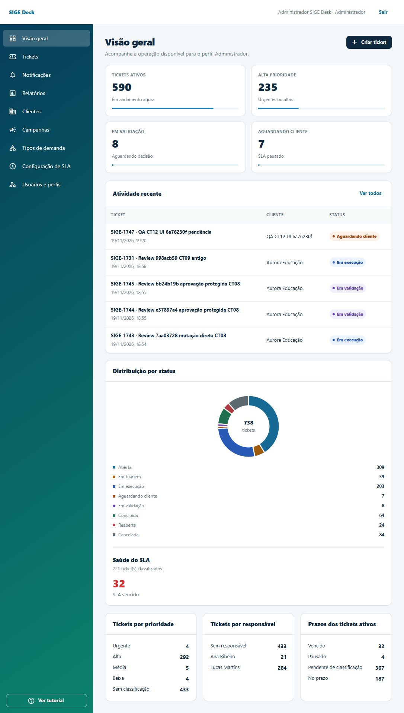
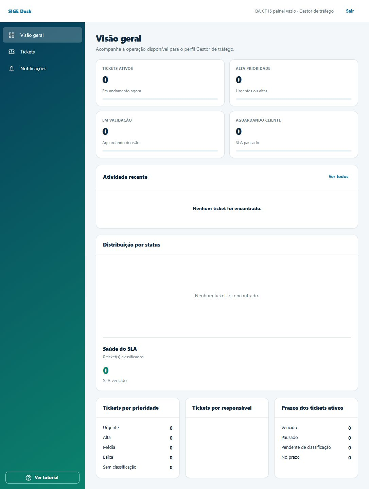

# CT-15 — fechamento da evidência de painel

**Decisão em 20/11/2026: Aprovado no escopo do catálogo.** A pendência anterior era de comprovação visual: faltavam captura preservada dos gráficos e confronto da interface com o dataset. Não foi necessário alterar o código da aplicação nesta rodada.

## Ambiente e procedimento

Frontend Vite em `http://localhost:5173`, proxy para API local `http://localhost:8081/api/v1`, schema MySQL `sige_desk_qa_20261118` e armazenamento `target/qa-uploads`. Foi retomado o JAR atual `target/sige-desk-api-0.1.0-SNAPSHOT.jar`, SHA-256 `bd065901d4e4338615c97370e33046b3a3a72223b5876534c05722fe1d7feba4`, com conexão explicitamente configurada para o schema de QA no processo iniciado para o teste. A publicação AWS não foi usada como base de teste mutável.

O [reteste compartilhado de filtros/painel](ct15-painel-reteste-20261120.json) passou 75 verificações HTTP/MySQL, incluindo distribuição, escopo, indicadores e partição dos prazos. O [roteiro da referência visual](../../Backend/scripts/qa_ct15_evidencia_visual.py) preservou o [dataset de 738 tickets e as respostas de sete sessões](ct15-referencia-visual-20261120.json), confrontando distribuições e quantidades com consultas diretas ao banco e verificando estabilidade dos registros durante a coleta. Os seis usuários demo representam os quatro perfis, duas organizações e dois responsáveis distintos.

Para o estado vazio, foi criado exclusivamente em QA o usuário sintético `ct15.vazio.20261120@sige.demo`, Gestor sem atribuições; nenhum ticket foi criado ou alterado. A primeira tentativa de criação usou a senha curta do perfil demo e foi recusada pela validação de senha mínima de 12 caracteres. O roteiro foi ajustado para fornecer uma senha de fixture compatível e a criação passou; foi falha na preparação do teste, sem defeito do produto. A conta foi mantida para reproduzir o painel vazio. Não foram exportadas senhas nos registros de resultado.

Na interface real, foram feitas sessões separadas e preservadas capturas JPEG de página inteira e textos de acessibilidade de todos os painéis. A inspeção verificou o gráfico de status, seus rótulos e legendas, as tabelas de prioridade, responsável e prazo, os indicadores e o estado vazio, sem sobreposição ou divergência observada no recorte. O gráfico omite categorias de status de valor zero; as demais distribuições exibem os grupos aplicáveis, incluindo sem classificação e sem responsável.

## Confronto dos painéis

| Sessão / captura | Total de tickets | Ativos | Alta/urgente ativos | Em validação | Aguardando Cliente | Vencido / pausado / pendente / no prazo (ativos) |
| --- | ---: | ---: | ---: | ---: | ---: | --- |
| [Admin](capturas-ct15-20261120/admin.jpg) | 738 | 590 | 235 | 8 | 7 | 32 / 4 / 367 / 187 |
| [Atendimento](capturas-ct15-20261120/atendimento.jpg) | 738 | 590 | 235 | 8 | 7 | 32 / 4 / 367 / 187 |
| [Cliente Aurora](capturas-ct15-20261120/cliente.jpg) | 652 | 508 | 165 | 6 | 4 | 25 / 4 / 359 / 120 |
| [Cliente Horizonte](capturas-ct15-20261120/cliente-externo.jpg) | 10 | 8 | 3 | 1 | 1 | 4 / 0 / 4 / 0 |
| [Gestor Lucas](capturas-ct15-20261120/gestor.jpg) | 284 | 223 | 217 | 8 | 3 | 30 / 4 / 4 / 185 |
| [Gestor Ana](capturas-ct15-20261120/gestor-nao-atribuido.jpg) | 21 | 18 | 18 | 0 | 2 | 2 / 0 / 14 / 2 |
| [Gestor sem atribuições](capturas-ct15-20261120/vazio.jpg) | 0 | 0 | 0 | 0 | 0 | 0 / 0 / 0 / 0 |

As somas de status, prioridade e responsável coincidiram com os totais autorizados. Os grupos de prazo somaram o total de ativos. Total de tickets e ativos têm bases distintas: Concluída e Cancelada entram nas distribuições gerais, mas não na partição de prazos ativos. O indicador de alta prioridade também considera somente ativos.

O [roteiro de confronto](../../Backend/scripts/qa_ct15_confrontar_capturas.py) comparou os textos capturados com a referência e passou **161/161 verificações**. O [resultado](ct15-confronto-capturas-20261120.json) contém valor esperado, observado, situação e SHA-256 de cada captura e texto. A primeira tentativa de confronto foi preservada em [tentativa 1](ct15-confronto-capturas-tentativa1-20261120.json): o texto de Admin continha somente uma diferença de árvore, não a árvore completa, produzindo 26 valores ausentes. O [texto incompleto](capturas-ct15-20261120/admin-ax-diff-incompleto.txt) foi mantido, e o painel de Admin foi recapturado com a árvore completa; o reteste passou sem alterar a expectativa nem os dados do produto.

O painel vazio mostrou contadores zero, atividade vazia e “Nenhum ticket foi encontrado.” na região do gráfico, sem a sobreposição anteriormente corrigida. O recorte positivo preservou os grupos sem classificação/sem responsável e quatro prazos pausados no escopo de Admin, Atendimento, Cliente Aurora e Gestor Lucas, ausentes nos escopos externos correspondentes.

## Alcance da aprovação

CT-15 passou a Aprovado pela combinação da evidência API/MySQL existente com este complemento de interface, dataset, capturas e confronto. A consolidação do catálogo passa a **17/17 (100%), com 11/11 altas**; nenhum defeito crítico novo foi observado neste complemento. Mantêm-se os limites dos demais casos e da revisão de defeitos conhecidos. A aprovação não comprova ausência universal de falhas, compatibilidade integral entre navegadores ou usabilidade com participantes. Esta rodada usou relógio real e dados já existentes; não acrescenta cobertura exaustiva de fronteiras temporais além dos testes controlados anteriores.

